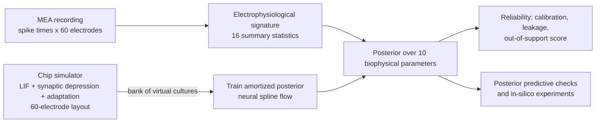

# NeuroTwin — calibrated digital twins of neural organ-on-a-chip cultures

NeuroTwin turns a microelectrode-array (MEA) recording of a neural chip culture into a **mechanistic,
uncertainty-aware digital twin**: a spiking-network model of that very chip whose biophysical parameters are
inferred with amortized simulation-based inference. The twin explains what the culture is doing (excitation,
inhibition, synaptic recovery, adaptation, wiring range), says how sure it is, flags recordings it cannot
explain, and can be run forward for in-silico experiments.

Entry to the Kaggle hackathon *AI4S Open Innovation: AI for Life Science* (AI + Organ-on-a-Chip track,
5th Pazhou Algorithm Competition). Category: **End-to-End System**. Status: work in progress.



## Repository layout

| Path | Contents |
|---|---|
| `src/neurotwin/sim.py` | Event-driven, numba-compiled spiking-network simulator of an MEA chip culture |
| `src/neurotwin/features.py` | Summary statistics (bursts, network bursts, synchrony, burst shape), same code for real and simulated data |
| `src/neurotwin/data.py` | Loader for the Wagenaar et al. (2006) recordings, windowed features |
| `src/neurotwin/infer.py` | Neural posterior estimation (sbi), leakage-aware sampling, recovery, SBC/TARP calibration |
| `src/neurotwin/ppc.py` | Posterior predictive checks |
| `kaggle/*/template.py` | Kaggle kernels; `tools/build_kernel.py` inlines the modules into one self-contained script |
| `tools/kgl.py` | Push a kernel, wait for it, fetch outputs and log |
| `docs/WRITEUP.md` | Living draft of the Kaggle writeup / technical report |

## Reproduce

```bash
pip install -r requirements.txt
```

Pipeline (each step is a Kaggle kernel; all run on CPU):

1. `kaggle/nt-realdata` downloads the 527 daily recordings of dense cultures and computes 300-s window features.
2. `kaggle/nt-simbank` (several shards) simulates virtual cultures drawn from the prior.
3. `kaggle/nt-train` trains the posterior, validates it on held-out simulations and fits every real recording.

Build and run a kernel locally or on Kaggle:

```bash
python tools/build_kernel.py kaggle/nt-realdata/template.py kaggle/nt-realdata/nt_realdata.py
python tools/kgl.py run kaggle/nt-realdata
```

## Data and licenses

- **MEA recordings:** D. A. Wagenaar, J. Pine, S. M. Potter (2006), *An extremely rich repertoire of bursting
  patterns during the development of cortical cultures*, BMC Neuroscience 7:11. Free for research use on the
  condition that the article is cited. Downloaded from potterlab.bme.gatech.edu at run time; not redistributed.
- **Planned imaging data:** Christiansen et al. (2018), *In silico labeling*, Cell 173:792 — CC BY 4.0.
- Third-party software: numpy, scipy, pandas, numba, PyTorch, sbi (Apache-2.0), matplotlib.
- AI assistance: implementation was assisted by an AI coding assistant (Claude); all results are produced by
  the code in this repository and verified by the team.

## License

To be confirmed by the team before publication.
