# NeuroTwin — calibrated digital twins of neural organ-on-a-chip cultures

NeuroTwin turns a microelectrode-array (MEA) recording of a neural chip culture into a **mechanistic,
uncertainty-aware digital twin**: a spiking-network model of that very chip whose biophysical parameters are
inferred with amortised simulation-based inference. The twin says what the culture is doing (excitation,
inhibition, synaptic dynamics, excitability), how sure it is, flags recordings it cannot explain, and can be
run forward for in-silico experiments.

Entry to the Kaggle hackathon *AI4S Open Innovation: AI for Life Science* (AI + Organ-on-a-Chip track, 5th
Pazhou Algorithm Competition). Category: **End-to-End System**. Full technical report: [docs/REPORT.md](docs/REPORT.md).

```mermaid
flowchart LR
  A[MEA recording<br/>spike times x 60 electrodes] --> B[Electrophysiological signature<br/>16 summary statistics]
  S[Chip simulator<br/>LIF + depression + adaptation<br/>fast and slow synapses, 60 electrodes] -->|bank of virtual cultures| T[Amortised posterior<br/>neural spline flow]
  B --> P[Posterior over biophysical parameters]
  T --> P
  P --> R[Reliability: calibration, out-of-support score,<br/>posterior leakage, predictive checks]
  P --> F[In-silico experiments]
  I[Phase-contrast images] --> V[Virtual staining with uncertainty<br/>nuclei and dead cells] --> Q[Structural readouts]
```



## What is in the box

| Path | Contents |
|---|---|
| `src/neurotwin/sim.py` | Event-driven, numba-compiled spiking-network simulator of an MEA chip culture; optional two-chamber (axon-diode) chips. Model versions v2→v4, each reproducing the previous one exactly at its neutral setting |
| `src/neurotwin/features.py` | 16 summary statistics (bursts, network bursts, synchrony, burst shape); the same code for real and simulated data |
| `src/neurotwin/directional.py` | Directional statistics for two-chamber chips (burst leaders, onset lags) |
| `src/neurotwin/data.py` | Loader for the Wagenaar et al. (2006) recordings |
| `src/neurotwin/infer.py` | Neural posterior estimation (sbi), leakage-aware sampling, recovery, SBC/TARP calibration |
| `src/neurotwin/ppc.py` | Posterior predictive checks |
| `src/neurotwin/vstain.py` | Uncertainty-aware virtual staining (U-Net, Gaussian NLL), nuclei / dead-cell readouts |
| `kaggle/*/template.py` | Kaggle notebooks; `tools/build_kernel.py` inlines the modules into one self-contained script |
| `app/app.py` | Interactive demo (Gradio): load a recording, fit its twin, run an in-silico experiment |
| `tools/` | Kaggle helpers (`kgl.py`, `chain.py`, `make_shards.py`), video pipeline (`make_video.py`, `tts.ps1`) |
| `docs/` | Technical report, writeup draft, video script |

## Quick start

```bash
pip install -r requirements.txt
python demo.py
```

`demo.py` is the entry script. It fits the twin of culture 2-2 at 20 days in vitro (minutes 20–25 of its
recording, downloaded from the public archive on first use) with the round-3 posterior shipped in
`assets/round3/`, states whether the fit can be trusted, re-simulates 16 posterior draws as a predictive check,
and runs two in-silico experiments (inhibition or excitation halved). It takes about 10 minutes on a 4-core
CPU and writes `demo_rasters.png`, `demo_comparison.csv` and `demo_draws.csv` to `runs/demo/`. Other
recordings: `python demo.py --recording 2-2-14 --start 0`, or your own two-column spike file with `--file`.
The same script runs as the Kaggle notebook `nt-demo`. For the interactive app, `pip install gradio` and run
`python app/app.py`.

## Reproduce everything

Everything runs on free Kaggle CPU sessions except the imaging ensemble (one GPU session). Each notebook is a
single script built from its template, pushed, run and fetched with the helpers in `tools/`:

```bash
python tools/build_kernel.py kaggle/nt-train3/template.py kaggle/nt-train3/nt_train3.py
python tools/kgl.py run kaggle/nt-train3        # push to Kaggle, wait, fetch outputs
python tools/report_pdf.py                      # docs/REPORT.md -> docs/NeuroTwin_report.pdf
```

The notebook chain (each a single script built from `kaggle/<name>/template.py`):

| Step | Notebook | Produces |
|---|---|---|
| Real data | `nt-realdata` | features of 3,049 five-minute windows from 522 recordings |
| Simulation banks | `nt-simbank*`, `nt-simbank2c` | virtual cultures for each round, and two-chamber chips |
| Inference | `nt-train*`, `nt-train2c` | posterior, calibration, real-data fits, predictive checks |
| Imaging | `nt-isldata2`, `nt-vstain2` | virtual-staining ensemble and test-well evaluation |
| Design study | `nt-design2c` | how recording length limits reading a two-chamber chip's wiring direction |
| Demo | `nt-demo` | one recording fitted end to end, with a predictive check and two in-silico experiments |

## Data and licences

- **MEA recordings:** D. A. Wagenaar, J. Pine, S. M. Potter (2006), *An extremely rich repertoire of bursting
  patterns during the development of cortical cultures*, BMC Neuroscience 7:11. Free for research use on the
  condition that the article is cited; downloaded at run time from the authors' archive, not redistributed.
- **Images:** Christiansen et al. (2018), *In silico labeling: predicting fluorescent labels in unlabeled
  images*, Cell 173:792 — CC BY 4.0; downloaded at run time.
- **Software:** numpy, scipy, pandas, matplotlib, numba, PyTorch, sbi (Apache-2.0), nflows, scikit-image.
- **AI assistance:** implementation was assisted by an AI coding assistant (Anthropic Claude); all results are
  produced by the code in this repository and were checked by the author.

## Licence

Apache License 2.0 — see [LICENSE](LICENSE).
