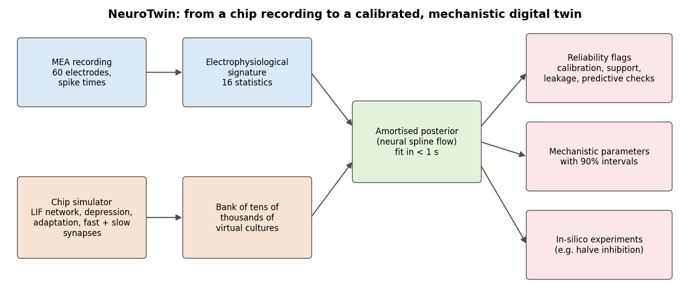
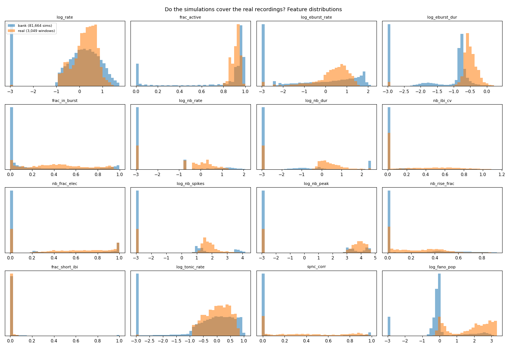
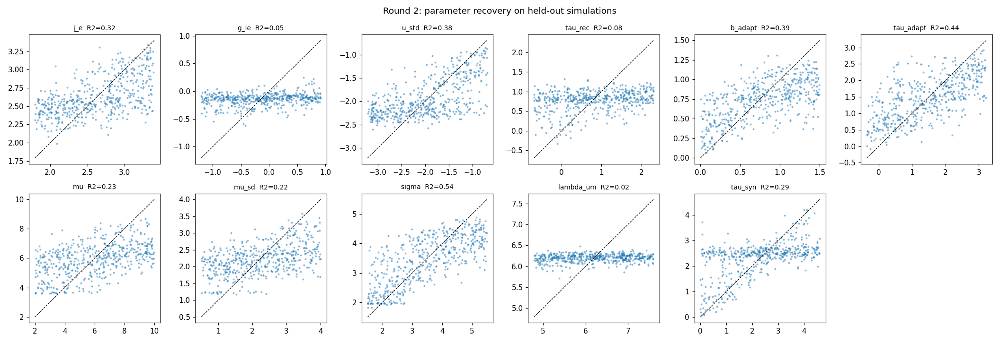
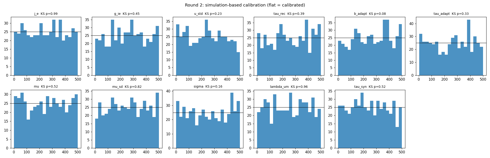
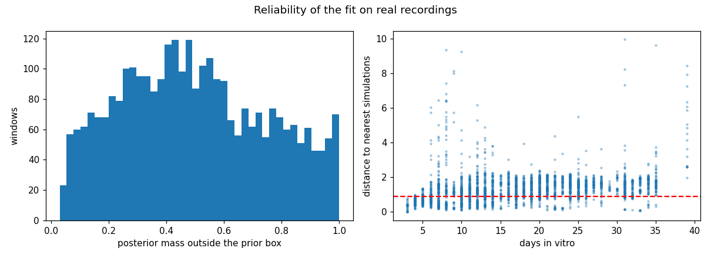
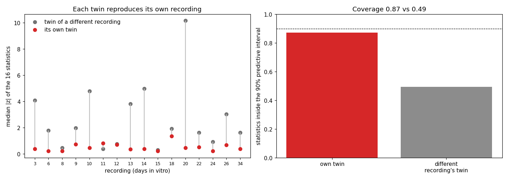
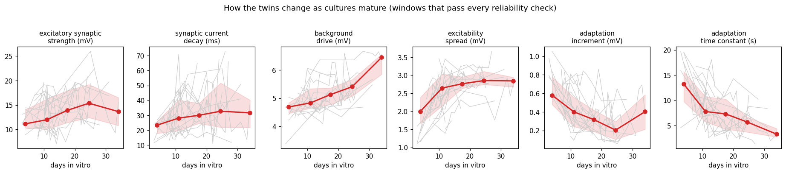
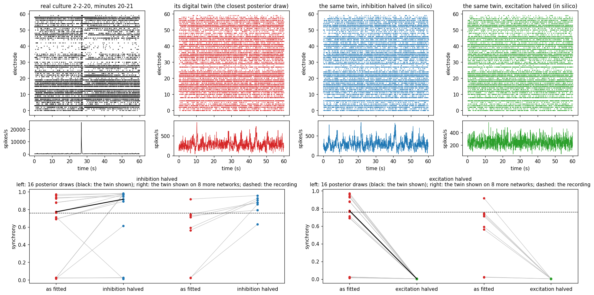
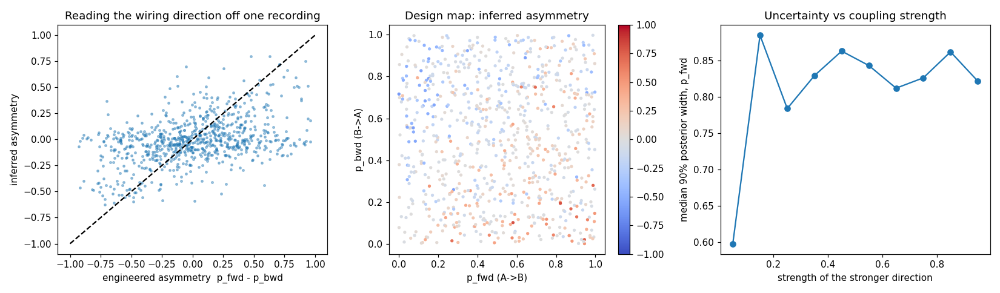

# NeuroTwin: calibrated digital twins of neural organ-on-a-chip cultures — technical report (draft)

> Draft v0.3 (2026-10-04). Results sections are filled only with measured numbers; `[TBD]` marks pending work.

## 1. Problem definition and application scenario

Neural organ-on-a-chip (OoC) platforms grow human or rodent neurons on engineered substrates such as
microelectrode arrays (MEAs) or compartmentalised microfluidic devices. Examples include the "axon diode"
chambers of Peyrin et al. (Lab Chip 2011), which force axons to grow in one direction to build oriented
circuits. These platforms are central to the shift towards human-relevant New Approach Methodologies. The US
FDA Modernization Act 2.0 (December 2022) removed the requirement for animal testing before human trials, and
in April 2025 the FDA published a roadmap to reduce animal testing that explicitly promotes organ-chips and
computational models. Bringing a single new medicine to market has been estimated to cost about US$2.6 billion
(DiMasi et al., 2016), and most candidates that enter clinical trials fail (Wong, Siah & Lo, 2019), so better
predictive in-vitro models have large practical value.

The readout of a neural chip, however, is descriptive. An MEA records tens of thousands of spikes per minute
on 60 or more electrodes. Experimenters summarise them as firing rates, bursts and synchrony, and then compare
conditions statistically. This leaves three gaps:

1. **Mechanism.** Two cultures can show similar burst statistics for different biophysical reasons (stronger
   excitation, weaker inhibition, slower synaptic recovery, more adaptation). Summary statistics alone cannot
   tell these apart.
2. **Uncertainty.** A single fitted value hides how well a mechanism is actually constrained by the data.
3. **Prediction.** Descriptive statistics cannot be run forward to ask what the chip would do under a new
   condition, a different wiring layout or a later developmental stage.

A **digital twin** closes these gaps. Here that means a mechanistic model of the specific chip whose
parameters are inferred from that chip's own recordings, with calibrated uncertainty. This is the stated goal
of the challenge's supporting company, CellShells, which aims at "AI-driven organ-on-a-chip digital twins" that
move the field "from experimental description toward predictive simulation".

**Scenario.** A lab records spontaneous MEA activity from neural chips every day, as in routine culture
quality control or developmental studies. NeuroTwin turns each recording into a posterior distribution over
the model's interpretable parameters (11 in model v3, 13 in model v4) in under a second on a CPU. It flags
recordings the model cannot explain, tracks parameter trajectories over days, and lets the user run the
fitted twin forward for in-silico experiments whose answers carry their own uncertainty (Figure 1).


*Figure 1. NeuroTwin end to end. A simulator of the chip generates a bank of virtual cultures; an amortised
posterior learned from that bank maps a recording's 16-statistic signature to its mechanistic parameters,
together with reliability flags, and the fitted twin can be run forward under changed conditions.*

## 2. Data, licenses and compliance

| Dataset | Content | Use | License / terms |
|---|---|---|---|
| Wagenaar, Pine & Potter (2006), BMC Neurosci. 7:11 | Spontaneous activity of dissociated rat cortical cultures on 60-electrode MEAs (Multi Channel Systems layout, 200 µm pitch), recorded daily from DIV 3 to about 39. Dense cultures: 527 recordings of 30 cultures from 8 platings | Real-data validation of the twin | Free for research use on the condition that the article is cited; downloaded at run time, not redistributed |
| Christiansen et al. (2018), Cell 173:792 ("in silico labeling"), condition `alicia_2_0` | Rat cortical cultures: 13-plane phase-contrast z-stacks with DAPI (nuclei) and propidium iodide (dead cells); 73 training / 8 test wells; includes the published model's predictions for the test wells | Label-free imaging module and published baseline | CC BY 4.0 |
| Simulated data | Virtual cultures generated by the NeuroTwin simulator | Training the amortised posterior | Generated by this project |

No human-subject, clinical or personal data are used. All processing code is public; each dataset is fetched
from its original source by the Kaggle notebooks.

**Pre-processing of MEA data.** Channel 60 (stimulus marker) is dropped. Each recording is cut into
consecutive, non-overlapping 300-s windows (up to 6 per recording), giving 3,049 windows from 522 recordings.
Five recordings contained no complete window.

## 3. Methods

### 3.1 Chip simulator

Each virtual culture has N = 400 leaky integrate-and-fire neurons (80% excitatory, 20% inhibitory) placed
uniformly at random on a 1.6 × 1.6 mm area. That area contains an 8 × 8 grid of electrodes at 200 µm pitch
with the four corners removed, giving 60 electrodes as in the real MEAs. Membrane potential follows

  V(t+Δt) = V∞,i(t) + (V(t) − V∞,i(t))·e^(−Δt/τm) + Σ_j w_ij·u·x_j·s_j(t) + σ·√(1−e^(−2Δt/τm))·ξ,

with V∞,i = V_rest + μ_i − a_i(t), τm = 20 ms, Δt = 1 ms, threshold V_rest + 15 mV, reset V_rest + 5 mV and a
2 ms refractory period. The per-neuron drive μ_i ~ N(μ, μ_sd²) models heterogeneous intrinsic excitability.
The terms are:

- **Connectivity.** Connection probability decays as exp(−d/λ) with distance d. It is normalised to a mean
  out-degree of 40, and there are no autapses.
- **Synaptic weights.** Excitatory weight J_E; inhibitory weight −g·J_E.
- **Short-term synaptic depression** (Tsodyks–Markram). Each presynaptic neuron has a resource x_j. A spike
  uses a fraction u of it, and it recovers with time constant τ_rec. This mechanism terminates network bursts.
- **Spike-frequency adaptation.** Each spike raises a_i by b, which then decays with time constant τ_a.
- **Synaptic kinetics.** Each spike delivers its weight through a current that decays with time constant
  τ_syn, normalised so the total voltage delivered per spike equals the weight. This sets how long a network
  burst lasts and its rise/decay shape. As τ_syn goes to zero the model reduces exactly to instantaneous
  synapses (model v2), which a regression test checks bit-for-bit.
- **Slow excitatory current (model v4).** A fraction f_slow of every excitatory weight is delivered through a
  second current that decays with time constant τ_slow, an NMDA-like component that can sustain long network
  bursts. At f_slow = 0 the model reproduces v3 bit-for-bit, again checked by a regression test.

Each electrode records the spikes of every neuron within 80 µm of its centre, which is about three neurons on
average, as in multi-unit recordings. The inner loop is event-driven: only the synapses of neurons that spiked
are touched. It is compiled with numba and parallelised over cultures. A 300-s culture costs about 8–10
CPU-core seconds: a 4-core Kaggle CPU session simulates about 1,850 cultures per hour (round 1: 81,664
cultures in 44 session-hours), and a 4-core laptop ran the 72 simulations of the worked example (§4.3) in
about six minutes.

The inferred parameters and their broad round-1 priors (uniform, or log-uniform where marked) are listed
below; later rounds sample focused sub-boxes of these ranges (§4.3, §4.4).

| Parameter | Meaning | Prior |
|---|---|---|
| J_E | excitatory synaptic efficacy (mV) | 0.5–20, log |
| g | inhibition/excitation ratio | 0.25–4, log |
| u | release probability | 0.02–0.8, log |
| τ_rec | synaptic recovery time (s) | 0.2–10, log |
| b | adaptation increment (mV) | 0–3 |
| τ_a | adaptation time constant (s) | 0.5–30, log |
| μ | mean drive (mV) | 0–14 |
| μ_sd | drive heterogeneity (mV) | 0–4 |
| σ | membrane noise (mV) | 1–6 |
| λ | connection length scale (µm) | 100–3000, log |
| τ_syn | synaptic current decay (ms) | 0.5–150, log (added in model v3) |
| f_slow | share of excitatory weight carried by the slow current | 0–0.8 (added in model v4) |
| τ_slow | slow excitatory current decay (ms) | 20–400, log (added in model v4) |

The priors were set by prior-predictive checks against the real recordings. A first version could not
produce the long, rare network bursts on top of tonic firing seen in real cultures. The fix was to add
excitability heterogeneity, to allow stronger synapses with lower release probability, and to allow slower
recovery and adaptation.

### 3.2 Electrophysiological signature

The same code computes 16 summary statistics for real and simulated windows:

- **Rates.** Mean firing rate per active electrode (active = at least 0.1 Hz) and the fraction of active
  electrodes.
- **Single-electrode bursts.** Detected by an ISI threshold (at least 4 spikes with ISI ≤ 100 ms): their rate,
  mean duration and the fraction of spikes that fall inside bursts.
- **Network bursts.** Defined as intervals in which at least max(3, 20%) of active electrodes burst at the same
  time; each is extended to the union of the overlapping electrode bursts, and bursts closer than 50 ms are
  merged. Statistics: rate, mean duration, coefficient of variation of inter-burst intervals, fraction of
  electrodes recruited, spikes per recruited electrode, peak population rate (10-ms bins), rise-time fraction
  and the fraction of inter-burst intervals shorter than 1 s.
- **Tonic firing rate** outside network bursts.
- **Synchrony.** The mean pairwise correlation of 100-ms spike counts.
- **Population burstiness.** The log Fano factor of 1-s population counts.

Rates are normalised by duration, and undefined statistics take fixed floor values, so every window yields a
finite vector.

### 3.3 Amortised Bayesian inference

We use neural posterior estimation (NPE; Papamakarios & Murray 2016, Greenberg et al. 2019) with a neural
spline flow (Durkan et al. 2019), implemented in `sbi` 0.27 (Tejero-Cantero et al. 2020). The flow is
trained on (θ, x) pairs from a bank of simulated cultures, with parameters mapped to the space where the prior
is uniform. After training, the posterior p(θ | x) is available for any window in milliseconds. This
amortisation is what makes population-scale twins of all 3,049 windows feasible.

**Reliability.** Three safeguards guard against over-confident or meaningless twins:

1. **Calibration** on 500 held-out simulations: parameter recovery (R², normalised RMSE, posterior
   contraction), coverage of the 50% and 90% central intervals, simulation-based calibration rank tests
   (Talts et al. 2018) and TARP expected coverage (Lemos et al. 2023).
2. **An out-of-support score** for every real window: the mean distance to its 10 nearest simulations in
   z-scored feature space, flagged above the 99th percentile of held-out simulations.
3. **Leakage.** This is the fraction of posterior mass that the flow places outside the prior box. Samples
   are clipped to the box rather than rejected, because rejection sampling stalls on out-of-support inputs.

**Posterior predictive checks.** Recordings spanning development are re-simulated from posterior draws, and
the observed statistics are compared with the predictive intervals. The baseline is a mismatched twin, drawn
from the posterior of a different recording (§4.2 explains why the prior is not a useful baseline).

**Focused rounds.** Rounds 2 and 3 concentrate simulations on the part of parameter space that real
recordings support: a sub-box around the simulations nearest to real windows, in the spirit of truncated
sequential NPE (Deistler et al. 2022). Each round's posterior is trained on that round's bank, with the box as
its prior, and is checked by the same reliability layer.

### 3.4 Label-free structural module

A U-Net maps a phase-contrast z-stack (5 focal planes in the first run, all 13 in the second) to DAPI and
propidium-iodide images of rat cortical cultures. The
images are block-averaged 2× to 1223 × 1223 pixels, since nuclei are about 25–40 px across at full
resolution. Each output pixel is a Gaussian: the network is trained with the heteroscedastic negative
log-likelihood, and, when a GPU is available, a 3-seed deep ensemble adds model uncertainty. One scale factor
recalibrates the predictive standard deviation to 90% coverage on validation wells.

The readouts are those an experimenter actually uses:

- **Nuclei count:** local maxima of the smoothed nuclear channel.
- **Dead-cell fraction:** nuclei with high propidium-iodide signal.

Their 90% intervals are obtained by sampling spatially smooth predictive noise. On the 8 official test wells,
the module is compared against the real stains and against the published 2018 model's predictions for the
same wells. The live-neuron density and viability it measures are the structural inputs for the twin.
Results are in §4.6.

### 3.5 Oriented-circuit twin and in-silico chip design

CellShells' founding lab builds oriented neuronal circuits with "axon diodes": two culture chambers joined by
asymmetric microchannels that let axons grow in one direction far more easily than in the other, with 97%
selectivity for the intended direction (Peyrin et al. 2011). The simulator has a two-chamber mode (`ChipConfig(compartments=2)`) that mirrors this geometry:

- **Somata and local wiring.** Somata are excluded from a 400 µm barrier strip in the middle of the chip,
  and local distance-dependent wiring stays within each chamber.
- **Channel crossings.** Each neuron in chamber A sends on average p_fwd·k_cross axons into chamber B, and
  each neuron in B sends p_bwd·k_cross axons into A (k_cross = 4, i.e. crossings are sparse relative to the
  40 local connections, as channel capacity limits how many axons cross). Axon targets are drawn near the
  channel exit, with an exponential decay length of 300 µm. Crossing synapses act after a 5 ms conduction
  and synaptic delay (a ring buffer in the event-driven loop); local synapses act on the next 1 ms step.
  A first version with 20 undelayed crossings per neuron fused the two chambers into one network, so that no
  onset measure could tell which chamber led.
- **Recording.** Electrodes over the barrier record no somata. This leaves 22 electrodes per chamber on the
  standard 60-electrode layout.

A single-chamber regression test confirms that the one-chamber model is unchanged by this extension.

**Directional signature.** Population events are detected on the smoothed total population rate (5-ms bins).
For each event, each chamber's onset is the first time its rate rises a quarter of the way from baseline to
its event peak. From these onsets the signature records:

- the fraction of events recruiting one or both chambers;
- the fractions of two-chamber events led by A or by B;
- a directionality index;
- the signed median onset lag;
- the lag of the peak of the chambers' rate cross-correlation;
- the chamber rate ratio and the cross-chamber synchrony.

**First validation on simulated ground truth.** Base parameters were set to a realistic bursting regime, and
each configuration was run with 3 network seeds and 180-s recordings; values are mean ± standard deviation
across seeds.

| Configuration | Median B−A onset lag | Burst-leader index | Events recruiting both chambers | Cross-chamber synchrony |
|---|---|---|---|---|
| Forward diode (p_fwd 0.9, p_bwd 0.05) | +34 ± 24 ms | +0.19 ± 0.16 | 67% | 0.82 |
| Reversed diode (p_fwd 0.05, p_bwd 0.9) | −40 ± 35 ms | −0.58 ± 0.47 | 42% | 0.68 |
| Symmetric (0.5 / 0.5) | +16 ± 121 ms | −0.07 ± 0.35 | 80% | 0.96 |
| Disconnected | — | — | 2% | −0.01 |

The signed onset lag recovers the direction of the engineered connectivity, and disconnected chambers are
correctly found to be independent. The leader index has the right sign but is noisier. A single recording is
therefore a noisy estimate of direction, which is why amortised inference combines all directional and global
statistics and reports its uncertainty on (p_fwd, p_bwd).

Posterior recovery of (p_fwd, p_bwd) and a design map of the inferred asymmetry are reported in §4.5; how
long a chip must be recorded to read its direction reliably is the next experiment.

## 4. Experiments and results

### 4.1 Round 1: does the simulator cover real recordings?

A first bank of **81,664 virtual cultures** of 300 s each was generated from the broad prior of §3.1 on four
Kaggle CPU sessions (about 44 session-hours; 19.2k / 20.9k / 22.0k / 19.6k per shard). Before fitting anything,
we asked whether real recordings lie inside the region the simulator can produce. Features were z-scored
using the bank, and each real window's distance to its 10 nearest simulations was compared with the same
quantity for 5,000 held-out simulations.

| Quantity | Value |
|---|---|
| 10-NN distance, held-out simulations (median) | 0.05 |
| 99th percentile (support threshold) | 0.87 |
| 10-NN distance, real windows (median) | 1.62 |
| **Real windows outside the simulated support** | **76.4%** |
| Simulations that burst synchronously | 12.9% |
| Distinct simulations acting as nearest neighbour to a real window | 451 of 81,664 |


*Figure 2. Round 1: marginal distributions of the 16 statistics in the simulation bank (blue) and in the
3,049 real windows (orange). Values of −3 are the floor of log-scaled statistics (no events).*

The mismatch is developmental: 0% of windows are outside the support at DIV 3–4, 60% at DIV 7, and 90–100%
from DIV 15 on. In other words the broad prior covers young, sparsely active cultures well and mature,
strongly bursting cultures poorly. Even the closest simulations to mature windows differ systematically:

| Feature | Real (DIV ≥ 15, median) | Closest simulation (median) |
|---|---|---|
| Network-burst duration | 2.1 s | 0.37 s |
| Burst rise fraction (peak position within the burst) | 0.23 | 0.48 |
| Population Fano factor (log10) | 2.86 | 2.07 |
| Single-electrode burst duration | 0.30 s | 0.16 s |

Two conclusions follow, and both shaped the next round:

1. **A model gap.** Instantaneous synapses cannot sustain a two-second burst with a fast rise and a slow
   tail. Model v3 therefore gives synapses an exponentially decaying current with a fitted time constant
   `tau_syn` (0.5–150 ms); as `tau_syn` goes to zero the model reproduces v2 bit-for-bit, which is checked
   by a regression test.
2. **A sampling gap.** Bursting cultures occupy a small part of the broad prior, so the bank is sparse
   exactly where the real data live. Round 2 concentrates simulations there, following the truncated
   sequential approach of Deistler et al. (2022).

Parameters of the simulations closest to mature recordings indicate where that region lies: strong
excitatory synapses (j_e ≈ 14 mV, 10–90% range 4.5–19), low release probability (u ≈ 0.14), recovery
τ_rec ≈ 1.1 s, weak adaptation (b ≈ 0.2 mV), drive µ ≈ 5.3 mV with a large spread (µ_sd ≈ 2.8 mV) and a
connection length scale of a few hundred µm.

### 4.2 Round 1: amortised inference and its self-diagnosis

A neural spline flow was trained on the round-1 bank (80,664 simulations for training, 1,000 held out;
57 min on a Kaggle CPU session).

**On simulated data the posterior is well calibrated.** Credible intervals hold their nominal coverage, and
the joint (TARP) coverage is essentially exact:

| | j_e | g_ie | u | τ_rec | b | τ_a | µ | µ_sd | σ | λ |
|---|---|---|---|---|---|---|---|---|---|---|
| R² (posterior mean vs truth) | 0.43 | 0.06 | 0.19 | 0.04 | 0.50 | 0.49 | 0.42 | 0.20 | 0.66 | 0.05 |
| 50% interval coverage | 0.46 | 0.51 | 0.45 | 0.45 | 0.51 | 0.50 | 0.52 | 0.54 | 0.55 | 0.49 |
| 90% interval coverage | 0.91 | 0.90 | 0.89 | 0.88 | 0.90 | 0.89 | 0.90 | 0.90 | 0.92 | 0.91 |
| SBC rank-uniformity p | 0.03 | 0.05 | 0.39 | 0.16 | 0.75 | 0.75 | 0.52 | 0.60 | 0.23 | 0.88 |

TARP expected-coverage deviation: −0.004 (0 is perfect), KS p = 1.00.

Calibration is therefore sound, but **identifiability is uneven**: membrane noise, adaptation, drive and
excitatory efficacy are constrained by the 16 statistics, whereas the inhibition ratio, synaptic recovery
time and wiring range are barely constrained under the broad prior. This is expected: most draws from that
prior produce silent or asynchronous cultures whose statistics say little about synaptic dynamics.

**On real data the twin declares itself invalid**, which is the intended behaviour of the reliability layer:

| Diagnostic | Round 1 |
|---|---|
| Real windows outside the simulated support | 75.4% |
| Mean posterior mass falling outside the prior box ("leakage") | 0.84 |
| Statistics inside the 90% posterior-predictive interval (12 recordings) | 0.73 |
| Median \|z\| of observed statistics under the fitted twin | 1.58 |

Round-1 fits to real recordings are therefore extrapolation rather than inference, and no biological
conclusion is drawn from them. This is what motivates model v3 and the focused round-2 prior of §4.1.

**A flawed baseline, and its replacement.** Round 1 compared the fitted twin against an "uninformed" prior
predictive drawn from the whole prior. That baseline covered 96% of statistics simply because it is
enormously wide, so the comparison flattered the baseline and means little. From round 2 on, the baseline is
a *mismatched* twin: parameters drawn from the posterior of a **different** recording. A twin is only useful
if it predicts its own recording better than another recording's twin does.

### 4.3 Round 2: model v3 and a prior focused on real cultures

The round-2 bank of **20,096 virtual cultures** used model v3 and sampled a box centred on the simulations
closest to mature real recordings. It concentrated simulations where they are useful: **28.7%** of them burst
synchronously, against 12.9% in round 1.

**Calibration on 500 held-out simulations remains sound.**

| | j_e | g_ie | u | τ_rec | b | τ_a | µ | µ_sd | σ | λ | τ_syn |
|---|---|---|---|---|---|---|---|---|---|---|---|
| R² | 0.32 | 0.05 | 0.38 | 0.08 | 0.39 | 0.44 | 0.23 | 0.22 | 0.54 | 0.02 | 0.29 |
| 90% coverage | 0.91 | 0.89 | 0.91 | 0.88 | 0.89 | 0.92 | 0.89 | 0.91 | 0.90 | 0.92 | 0.92 |
| SBC rank p | 0.99 | 0.45 | 0.23 | 0.39 | 0.08 | 0.33 | 0.52 | 0.82 | 0.16 | 0.96 | 0.52 |

TARP expected-coverage deviation −0.009. As in round 1, the inhibition ratio, synaptic recovery time and
wiring range are not identified by the 16 statistics and are reported only with their (wide) posteriors.


*Figure 3. Round 2: posterior mean against the true value for 500 held-out simulations (log-uniform
parameters on a log axis). The flat clouds are the three unidentified parameters.*


*Figure 4. Round 2: simulation-based calibration ranks. Flat histograms mean the posterior's uncertainty is
honest; the p-values are Kolmogorov–Smirnov tests of uniformity.*

**On real data the twin is now useful where it says it is, and only there.**

| Diagnostic | Round 1 | Round 2 |
|---|---|---|
| Real windows outside the simulated support | 75.4% | 72.3% |
| Mean posterior leakage | 0.84 | 0.50 |
| Windows passing every reliability check (in support and leakage < 0.2) | — | 341 / 3,049 (11.2%) |

The reliable windows span the whole of development: 26 of 355 windows at DIV ≤ 6, 79 / 444 at DIV 7–10,
82 / 511 at DIV 11–14, 61 / 717 at DIV 15–21, 69 / 598 at DIV 22–28 and 24 / 424 at DIV 29–40.


*Figure 5. Round 2 on real data. Left: posterior mass outside the prior box for each of the 3,049 windows.
Right: distance to the nearest simulations against age; windows above the dashed support threshold are
flagged as extrapolation.*

**The fitted twin is specific to its recording.** For 16 reliable recordings spanning development, 24
posterior draws were re-simulated and their statistics compared with the recording. The baseline is a
*mismatched* twin: draws from the posterior of a different recording.

| | Own twin | Mismatched twin |
|---|---|---|
| Statistics inside the 90% predictive interval | **0.87** | 0.49 |
| Median \|z\| of the observed statistics | **0.41** | 1.85 |
| Recordings where the own twin fits better | **94%** | — |

Per statistic, the own twin's 90% interval contains the observation for at least 88% of recordings on 13 of
the 16 statistics. The exceptions are single-electrode burst duration (19%), the fraction of spikes inside
bursts (50%) and network-burst duration (81%). These are the burst-morphology statistics that motivated
model v4.


*Figure 6. Posterior predictive checks on 16 reliable recordings from DIV 3 to 34. Left: median |z| of the 16
statistics under each recording's own twin (red) and under the twin of a different recording (grey). Right:
share of statistics inside the 90% predictive interval.*

**What the twins say about maturation.** Keeping only windows that pass every reliability check leaves 134
culture-days from 29 cultures (Figure 7). Twenty cultures have reliable windows on at least three different
days, so each can act as its own control. For every culture and parameter we take the sign of the
correlation between age and the posterior median, and test the twenty signs against a fair coin (two-sided
binomial test).

| Posterior median | DIV ≤ 8 | 9–14 | 15–21 | 22–28 | 29–40 | Cultures rising with age | Sign-test p |
|---|---|---|---|---|---|---|---|
| Background drive µ (mV) | 4.69 | 4.84 | 5.13 | 5.41 | 6.45 | 16 / 20 | 0.012 |
| Excitability spread µ_sd (mV) | 2.00 | 2.64 | 2.76 | 2.85 | 2.84 | 16 / 20 | 0.012 |
| Adaptation increment b (mV) | 0.58 | 0.40 | 0.32 | 0.20 | 0.40 | 3 / 20 | 0.003 |
| Adaptation time constant τ_a (s) | 13.2 | 7.8 | 7.3 | 5.7 | 3.3 | 4 / 20 | 0.012 |
| Excitatory efficacy j_e (mV) | 11.2 | 12.0 | 13.9 | 15.4 | 13.7 | 14 / 20 | 0.115 |
| Synaptic decay τ_syn (ms) | 23.4 | 28.1 | 30.0 | 32.7 | 31.7 | 11 / 20 | 0.82 |
| *Culture-days* | *24* | *53* | *28* | *23* | *6* | | |

Four of the six trends survive a Benjamini–Hochberg correction at a 5% false-discovery rate (drive,
excitability spread and both adaptation parameters); the stricter Holm correction keeps only the adaptation
increment. Within the model, maturing cultures are explained by stronger and more heterogeneous background
drive and by weaker, faster spike-frequency adaptation, with a weaker tendency towards stronger excitatory
synapses. Two caveats apply. The parameters are effective quantities of a reduced model (§5), so these are
testable hypotheses about mechanism — for example, by measuring afterhyperpolarisation currents at two ages —
rather than measurements. And the share of windows that pass the reliability checks varies with age (6–18%),
so the trends describe the part of each culture's repertoire that the model reproduces.


*Figure 7. Posterior medians of reliable windows against age. Grey: individual cultures; red: median and
interquartile range per age bin.*

**A worked example and two in-silico experiments.** The `nt-demo` notebook fits the twin of culture 2-2 at
DIV 20 from minutes 20–25 of its recording (Figure 8). By then the culture fires large network bursts that
recruit most electrodes (synchrony 0.76); the first ten minutes of the same recording are much quieter, a
reminder that a five-minute window is a snapshot. The amortised posterior returns 500 draws in about 0.2 s on a
laptop CPU, and the window passes both checks: its distance to the nearest simulations is 0.78 against a
threshold of 0.90, and 11% of the posterior mass falls outside the parameter box. Re-simulating 16 posterior
draws, each on its own random network, places 15 of the 16 observed statistics inside the draws' 90% range.
The one miss is network-burst duration — real bursts last longer — the gap that model v4 addresses.

The draws are not equally good. Their simulated statistics lie between 0.61 and 6.0 from the recording
(z-scored distance; median 2.25), and Figure 8 shows the closest draw. It matches the recording's synchrony
(0.74 vs 0.76), population Fano factor (log10 2.58 vs 2.75), share of spikes in bursts (0.44 vs 0.45) and
burst recruitment (0.43 vs 0.43), but it fires network events more often (log10 0.94 vs 0.41 per minute). On 8
further random networks the same parameters give synchrony between 0.05 and 0.65, so part of its close match
is the particular network it was built on: for a bursting culture, which neurons happen to connect matters as
well as the parameters.

The twin was then asked two questions the recording cannot answer: what would this culture do with half its
inhibition, or with half its excitation? Halving either corresponds roughly to a partial pharmacological block
of GABA-A or AMPA receptors, a routine MEA experiment. Each modified run is paired with an unmodified run on
the same network with the same noise, so a pair differs only by the intervention, and two sources of spread
are kept apart: parameter uncertainty (16 posterior draws) and network randomness (the twin shown, on 8
further networks).

| Synchrony | Twin shown | Twin shown, 8 further networks | 16 posterior draws |
|---|---|---|---|
| As fitted (recording: 0.76) | 0.74 | 0.05 to 0.65 | median 0.72, 90% range 0.01 to 0.99 |
| Inhibition halved | 0.97 | rises by 0.31 to 0.90 on all 8 | median change +0.09 (90% range 0.00 to +0.91); rises by more than 0.05 in 9, falls in none |
| Excitation halved | 0.01 | falls to 0.01 or less on all 8 | falls to 0.02 or less in all 16 |

Halving excitation gives the firmer answer: network bursting stops in every draw and on every network.
Halving inhibition never lowers synchrony. It raises it by more than 0.05 in 9 of the 16 draws; the draws
already close to full synchrony stay there, and two silent draws stay silent. How much it rises depends on
parameters the recording leaves undetermined, above all the inhibition ratio itself (R² 0.05 on simulations,
against 0.32 for excitatory efficacy). The calibrated answers are therefore "silent" and "more synchronous, by an uncertain
amount". The second points to the measurement that would sharpen it: an independent handle on inhibition, such
as one pharmacological titration. A point-estimate twin would have given both answers with the same false
confidence. The public recordings contain no pharmacology, so neither prediction is validated here; both can be
tested on the same chip. An earlier version of this experiment compared runs on different random networks,
which conflates the intervention with network randomness; pairing the runs removed that confound.


*Figure 8. Worked example (culture 2-2, DIV 20, minutes 20–25). Top: one minute of the recording, of the
closest posterior draw, and of the same twin — same network, same noise — with inhibition or excitation
halved. Bottom: each intervention's effect on synchrony across 16 posterior draws (left pair; black: the twin
shown) and for the twin shown on 8 further random networks (right pair). Dashed lines: the recording.*

### 4.4 Round 3: model v4

A local grid at the parameters closest to mature cultures showed that adding a slow excitatory current
(fraction 0.3–0.6 of each excitatory weight, decay 80–200 ms) lengthens network bursts from 0.29 s to about
0.9 s. It also brings single-electrode burst duration (−0.59 vs −0.52 in log10 s) and inter-burst firing
(0.54 vs 0.50 in log10 Hz) to the real values, while keeping the population Fano factor near 3. The burst
rise fraction stayed near 0.5 against 0.23 in real cultures, so it is excluded from inference in round 3 as a
documented misspecified statistic. It is still checked in the posterior predictive checks. A 3-shard bank of
model-v4 cultures and the round-3 posterior are in progress. [TBD: round-3 results.]

### 4.5 Oriented-circuit twin: reading the wiring direction

A posterior over the ten base parameters plus the forward and backward crossing probabilities was trained on
**18,560** simulated two-chamber chips (model v2; 26 statistics: 16 global and 10 directional), with 800 held
out.

| | p_fwd | p_bwd | u | b | τ_a | j_e |
|---|---|---|---|---|---|---|
| R² | 0.15 | 0.23 | 0.64 | 0.52 | 0.43 | 0.40 |
| 90% coverage | 0.88 | 0.91 | 0.91 | 0.90 | 0.92 | 0.93 |

TARP deviation −0.013. The posterior is honest about the wiring, but a five-minute recording says little
about it. The sign of the engineered asymmetry (p_fwd − p_bwd) is recovered in **61.9%** of held-out chips
overall, and in 63.6–64.1% when the asymmetry exceeds 0.3. The asymmetry estimate explains 17% of the
variance, and the 90% interval for p_fwd is typically 0.8 wide.


*Figure 9. Two-chamber chips (simulated ground truth). Left: inferred against engineered asymmetry for 800
held-out chips. Middle: inferred asymmetry over the design space of crossing probabilities. Right: width of
the 90% interval for p_fwd against the strength of the stronger direction.*

This result is weak, and we say so. It is consistent with the earlier ground-truth test, in which the
onset lag recovered the direction cleanly for strong diodes (+34 ± 24 ms versus −40 ± 35 ms) but was noisy in
general. Crossings are sparse (k_cross = 4) and five minutes contain few chamber-spanning events. The design
question this raises — how long must a chip be recorded to read its direction reliably — is the next
experiment. [TBD: recording-length study.]

### 4.6 Label-free imaging

**First run** (CPU, one model, 5 of 13 focal planes, 2,500 iterations; 8 official test wells):

| | Ours | Published in-silico-labeling model |
|---|---|---|
| Pixel Pearson r, nuclei (DAPI) | 0.81 | 0.92 |
| Pixel Pearson r, dead cells (PI) | 0.71 | 0.85 |
| Nuclei count, mean absolute % error (true mean 509) | 89% | 4.8% |
| Dead-cell fraction (true 0.26) | 0.45 | 0.27 |

Two lessons. First, the model is below the published one in pixel fidelity. Second, and more important for
an uncertainty-aware tool, its blurrier predictions produced spurious nuclei that per-pixel uncertainty did
not capture: the 90% readout intervals contained the true count in 0 of 8 wells. A readout must therefore be
calibrated on validation data, not only its pixels.

**Second run** (GPU, three-model ensemble, all 13 planes, 8,000 iterations, readout calibrated on 8
validation wells). Mixed-precision training made one ensemble member diverge (NaN) and another unstable, and
the corrupted ensemble lowered pixel correlation (0.71 / 0.29). Even so, the nuclei count reached **8.1%**
error with the default readout, and the validation-derived intervals contained the true count in **7 of 8**
test wells. The calibrated readout did worse (18.4%), because its joint objective was dominated by the
collapsed dead-cell channel. A corrected run is pending: full precision, gradient clipping, diverged members
dropped, and counts and dead fraction calibrated separately. [TBD: corrected results.]

## 5. Reliability analysis and limitations

**What the reliability layer checks.** Four independent signals, each of which can veto a fit:

1. *Calibration on simulations* (SBC ranks, interval coverage, TARP) shows whether the stated uncertainty is
   honest when the model is correct.
2. *Out-of-support score* shows whether a real recording resembles anything the simulator can produce.
3. *Posterior leakage* shows whether the flow is pushing mass outside the parameter ranges, the signature of
   a recording the model cannot explain.
4. *Posterior predictive checks* show whether re-simulated twins reproduce their own recording, and do so
   better than the twin of a different recording.

Round 1 passed the first check and failed the other two, and we report that rather than the biological
narrative the round-1 trajectories would have suggested. This is the intended behaviour: a twin that cannot
say "I do not know" is worse than no twin.

**Limitations, stated plainly.**

- *The model is phenomenological.* Four hundred leaky integrate-and-fire neurons stand in for tens of
  thousands of real ones, so the inferred parameters are effective quantities of that reduced model, not
  measured cellular constants. They are comparable across recordings analysed the same way; they are not
  calibrated biophysics.
- *Not every parameter is identifiable.* Under the round-1 prior the inhibition ratio, synaptic recovery time
  and wiring range were barely constrained by the 16 statistics (R² ≤ 0.06). Identifiability is reported per
  parameter, and unidentified parameters must not be read as findings.
- *The summary statistics are a choice.* They were fixed before fitting and applied identically to real and
  simulated data, but a different set would give different identifiability.
- *One twin per window.* Each 300-s window is fitted independently; the twin has no memory of the culture's
  earlier days. Trajectories are therefore a sequence of independent fits, not a dynamical model of
  development.
- *Structure and function are validated separately.* The imaging module and the electrophysiological twin use
  different public datasets (the same cell type, not the same cultures), so the structure-to-function link is
  a designed interface, not yet a jointly validated inference.
- *The oriented-chip twin is validated on simulated ground truth only.* No public recordings from
  compartmentalised axon-diode chips were found, so the directional results show what the method recovers
  when the answer is known, not a measurement of a real device.
- *Recording length matters.* Five-minute windows contain few network bursts in slow-bursting cultures, which
  widens the posterior; this is visible in the reported uncertainty rather than hidden.
- *Amortised posteriors are calibrated on average, not for each recording.* Coverage, SBC and TARP average
  over simulated data. For a single recording the posterior can be broader than the data warrant: in the
  worked example, the re-simulated draws lie between 0.61 and 6.0 from the recording, and only some of them
  look like it. A short
  per-recording refinement — a truncated sequential round started from the amortised posterior (Deistler et
  al., 2022) — would sharpen such twins at a cost of minutes rather than milliseconds.
- *In-silico predictions inherit the posterior's uncertainty.* An intervention on a weakly identified
  parameter (here the inhibition ratio) gives a robust direction but an uncertain size, while one on a better
  identified parameter (excitatory efficacy) gives a firm answer. The twin reports both, and the spread across
  posterior draws is the quantity a follow-up experiment should reduce.
- *Network randomness is part of the twin.* A twin is a distribution of networks with the same statistics, not
  one wiring diagram; for a bursting culture the same parameters give visibly different synchrony on different
  random networks, so a single simulated network should not be read as the culture's wiring.

## 6. Potential impact

Neural organ-on-a-chip platforms are becoming a routine part of preclinical work: the FDA Modernization Act
2.0 (December 2022) removed the animal-testing requirement, and the FDA's April 2025 roadmap explicitly
promotes organ-chips and computational models as New Approach Methodologies. The economics are stark, with
roughly US$2.6 billion of capitalised R&D per approved drug (DiMasi et al., 2016) and most clinical
candidates failing (Wong et al., 2019). Chips only help if their readouts support decisions.

NeuroTwin adds three things to a neural-chip workflow, each of which is a concrete saving rather than a
claim of novelty for its own sake:

1. **Mechanism instead of description.** Two cultures with the same burst rate can differ in excitation,
   inhibition, synaptic recovery or excitability spread. The twin separates these, with an interval on each.
2. **In-silico experiments.** A fitted twin can be run under changes that were never performed, so an
   experiment can be prioritised rather than guessed. Predictions are falsifiable on the same chip.
3. **A safety net.** Every fit carries machine-checkable reliability flags, so a twin that does not apply
   says so instead of producing a confident number. For a company building "data assets" out of chip
   recordings, that distinction is what makes the asset trustworthy.

The cost of entry is low: everything here runs on ordinary CPUs, the inference for a new recording takes
about a second, and the code and data are public.

## 7. Reproduction

Every number in this report comes from a notebook in `kaggle/`, each of which is a single self-contained
script built from a template by `tools/build_kernel.py` (it inlines the modules in `src/neurotwin/`, so a
notebook has no private dependencies). All of them run on ordinary CPU sessions; only the imaging notebook
`nt-vstain2` uses a GPU, and its CPU predecessor `nt-vstain` shows the same pipeline without one.

| Step | Notebook | Input | Output | Runtime |
|---|---|---|---|---|
| 1 | `nt-realdata` | downloads 527 recordings from the Potter-lab archive | `wagenaar_dense_features.csv` (3,049 windows) | ~9 min |
| 2 | `nt-simbank2/shards/s*` | none | round-2 bank `bank2_shard*.npz` (model v3, focused prior) | 11 h per shard |
| 3 | `nt-train2` | steps 1–2 | `posterior.pt`, `calibration.json`, `real_posteriors.csv`, `ppc*.csv`, `twin_assets.npz`, figures | ~1–2 h |
| 4 | `nt-demo` | steps 1, 3 | one worked example: fit, reliability verdict, predictive check, two in-silico experiments | ~10 min |
| 5 | `nt-isldata` | downloads the in-silico-labeling rat cortical wells | 81 wells (73 train / 8 test) as compact arrays | ~4 min |
| 6 | `nt-vstain` | step 5 | virtual-staining ensemble, test metrics against the published baseline, figures | ~1–2 h CPU |
| 7 | `nt-simbank2c` | none | two-chamber bank with directional statistics | 11 h |
| 8 | `nt-train2c` | step 7 | posterior over crossing probabilities, design map | ~1 h |

Locally:

```bash
pip install -r requirements.txt
python tools/build_kernel.py kaggle/nt-train2/template.py kaggle/nt-train2/nt_train2.py
python tools/kgl.py run kaggle/nt-train2          # push to Kaggle, wait, fetch outputs
python app/app.py                                  # interactive demo, reads the training outputs
```

**Determinism.** Every simulation batch draws its seeds from one generator seeded per notebook, and each
virtual culture is simulated independently, so results are reproducible given the same seed and bank. The
posterior is trained with a fixed torch seed; small numerical differences across BLAS versions can move the
last digit of the metrics but not the conclusions.

**Provenance note.** The first round-2 shard was pushed, through a naming mistake in our shard generator, as
a new version of the round-1 notebook `nt-simbank-s0`; it runs the round-2 script and produces
`bank2_shard0.npz`. The round-1 bank remains available as version 1 of that notebook. The public release
uses correctly named notebooks. Each built script in `kaggle/<notebook>/` is the exact file that ran on Kaggle; rebuilding
a template with the current `src/` gives the latest model version, which reproduces the earlier versions
exactly at their neutral settings (§3.1).

## 8. Team

[TBD — to be confirmed by the team, including disciplinary backgrounds.]

## 9. External resources and AI tools

numpy, scipy, pandas, matplotlib, numba, PyTorch, sbi, nflows. Implementation was assisted by an AI coding
assistant (Anthropic Claude); design decisions and results were verified by the team.

## References

- Christiansen E.M. et al. (2018). In silico labeling: predicting fluorescent labels in unlabeled images. *Cell* 173:792–803. doi:10.1016/j.cell.2018.03.040
- Deistler M., Goncalves P.J., Macke J.H. (2022). Truncated proposals for scalable and hassle-free simulation-based inference. *NeurIPS*.
- DiMasi J.A., Grabowski H.G., Hansen R.W. (2016). Innovation in the pharmaceutical industry: new estimates of R&D costs. *J. Health Econ.* 47:20–33. doi:10.1016/j.jhealeco.2016.01.012
- Durkan C., Bekasov A., Murray I., Papamakarios G. (2019). Neural spline flows. *NeurIPS*.
- Gonçalves P.J. et al. (2020). Training deep neural density estimators to identify mechanistic models of neural dynamics. *eLife* 9:e56261. doi:10.7554/eLife.56261
- Greenberg D., Nonnenmacher M., Macke J. (2019). Automatic posterior transformation for likelihood-free inference. *ICML*.
- Lemos P. et al. (2023). Sampling-based accuracy testing of posterior estimators for general inference. *ICML*.
- Papamakarios G., Murray I. (2016). Fast ε-free inference of simulation models with Bayesian conditional density estimation. *NeurIPS*.
- Peyrin J.-M. et al. (2011). Axon diodes for the reconstruction of oriented neuronal networks in microfluidic chambers. *Lab Chip* 11:3663–3673. doi:10.1039/c1lc20014c
- Talts S. et al. (2018). Validating Bayesian inference algorithms with simulation-based calibration. *arXiv:1804.06788*.
- Tejero-Cantero A. et al. (2020). sbi: a toolkit for simulation-based inference. *J. Open Source Softw.* 5:2505.
- Tsodyks M., Uziel A., Markram H. (2000). Synchrony generation in recurrent networks with frequency-dependent synapses. *J. Neurosci.* 20:RC50. doi:10.1523/JNEUROSCI.20-01-j0003.2000
- Wagenaar D.A., Pine J., Potter S.M. (2006). An extremely rich repertoire of bursting patterns during the development of cortical cultures. *BMC Neurosci.* 7:11. doi:10.1186/1471-2202-7-11
- Wong C.H., Siah K.W., Lo A.W. (2019). Estimation of clinical trial success rates and related parameters. *Biostatistics* 20:273–286. doi:10.1093/biostatistics/kxx069
- US FDA (2025). Roadmap to reducing animal testing in preclinical safety studies. https://www.fda.gov/media/186092/download
- FDA Modernization Act 2.0, S.5002, 117th Congress (2022).
